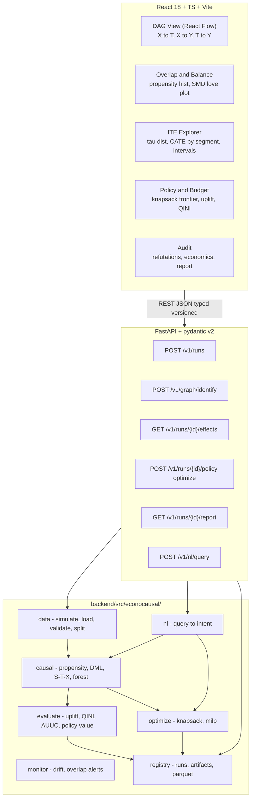

# EconoCausal: Dynamic Pricing via Double ML — Architecture (Week 1)

> **Status:** DESIGN FIRST — no feature code. Build contract for Weeks 1–4.
> **Timeline:** 10 Oct → 10 Nov 2026. Week 1: design + skeleton + simulator slice.
> **Stack:** Python 3.11, `uv` + `pyproject.toml` (pinned + lockfile), DoWhy + EconML + LightGBM, SciPy HiGHS, pandas/numpy/pyarrow/pandera, FastAPI + pydantic v2, React 18 + TS + Vite + Tailwind + Plotly + TanStack Query/Table + React Flow.
> **Privacy:** Repo private until company approves. Never copy confidential docs or reference numbers in.

## 0. Problem

Standard ML predicts `P(buy | X)`. We need `tau(X) = E[Y(1)-Y(0) | X]` (ITE) — who buys *because of* the discount — then spend a fixed budget only where `incremental_profit(X) > 0`.

| Type | Y(0) | Y(1) | tau | Action |
|---|---|---|---|---|
| Persuadable | 0 | 1 | +1 | Target — only positive lift |
| Sure Thing | 1 | 1 | 0 | Skip — zero lift, pay cost |
| Lost Cause | 0 | 0 | 0 | Skip |
| Sleeping Dog | 1 | 0 | -1 | Never — negative effect |

Confounding: history targeted lapsed, high-value users, so `T <- X -> Y`. Naive `E[Y|T=1]-E[Y|T=0]` is biased. Double ML (orthogonalization + cross-fitting) de-biases.

Week 1 scope: this doc + skeleton + contracts + synthetic simulator. Non-goals: multi-valued discount, sequential pricing, realtime SLA, auto-retrain (stub in `monitor/`).

## 1. System diagram

### Mermaid (source of truth; also drives React Flow DAG view)



### ASCII fallback

```
[React] --REST/JSON--> [FastAPI /v1/*]
  DAG | Overlap | ITE | Policy | Audit
                              |
  data/ -> causal/ -> evaluate/optimize/ -> registry/
  simulate  DML+forest  knapsack/uplift     runs+parquet
```

Rule: optimize,evaluate,monitor,nl depend on causal; causal on data; data on registry. Registry imports no domain code. api/ is thin glue. Frontend uses only OpenAPI types.

## 2. Pipeline (only path to prod numbers)

```
raw CSV or simulator
  -> 1 validate (pandera) -> 2 split (seeded, stratify T)
  -> 3 propensity + overlap gate -> 4 Double ML cross-fit
  -> 5 ITE + intervals -> 6 refutation audit
  -> 7 economics -> 8 budget optimize -> 9 report
```

| # | Stage | Owner | Gate |
|---|---|---|---|
| 1 | Ingest+Validate: pre-treatment X, binary T, Y, cost, margin. Reject 422 on schema fail. Drop null T/Y rows, never impute T. | data/ | pandera fail = reject, no silent coerce |
| 2 | Split: train/eval/policy, one seed, stratify T. Eval never trains nuisances (honest eval). | data/ | seed in run config |
| 3 | Propensity+Overlap: m(X)=P(T=1\|X), SMD, ESS, hist. History targeted lapsed+valuable so overlap will be thin. | causal.propensity | >15pct mass outside [0.025,0.975] or low ESS = WARN + trim + block policy until acknowledged |
| 4 | Double ML: 5-fold cross-fit LightGBM g(X)=E[Y\|X], m(X)=E[T\|X], clip m. Out-of-fold residuals, final-stage CATE. | causal.dml | no nuisance fit on eval fold |
| 5 | ITE+Intervals: tau_hat(X) + lo/hi. Forest variance or LinearDML analytic CI. | causal/ | store point+interval |
| 6 | Refutation audit via DoWhy: placebo, subset, add-noise. | causal.refute | fail = run needs_review, policy watermarked |
| 7 | Economics: incremental_profit = tau*margin - unit_cost. Pure numpy function. | optimize.economics | Sleeping Dogs always negative |
| 8 | Optimize: binary pi(X) s.t. budget. linprog/HiGHS default to ~100k; milp only N<=2k; greedy-ROI fallback. | optimize/ | never force-spend; empty assignment allowed |
| 9 | Report: JSON+MD, every number has run_id+git_sha+seed+config_hash. | registry/+api/ | no number without provenance |

Simulator (Week 1): emits 4 types with known tau_true, confounded T ~ Bernoulli(sigmoid(lapsed+value)). Oracle policy uses tau_true, synthetic-only, API-refused on real data.

## 3. Model lineup and role of each

### 3.1 Estimators — one interface: fit(Y,T,X) -> tau_hat + intervals

- Naive diff-in-means: bias demo only. Proves confounding. Never for policy.
- S-learner (LightGBM, T as feature): cheap baseline; shrinks heterogeneity toward 0.
- T-learner (two LightGBMs): better heterogeneity; overfits thin-T regions; no orthogonality.
- X-learner: imbalanced-T baseline; good for our skew; still no Neyman orthogonality.
- LinearDML: interpretable baseline + CI reference. Fast, stable; misses nonlinearity. Ship first to unblock API.
- CausalForestDML (primary): final ITE + honest intervals. Captures tau(X). Slow; see R1.

Pick winner on eval split: PEHE (synthetic), policy value / AUUC / QINI, coverage. Never train fit.

### 3.2 Policy baselines

- Random: floor. Must beat.
- Predictive targeting P(Y|X): strawman wasting budget on Sure Things. Proves prediction != causation.
- DML-greedy/Knapsack (ours): top incremental_profit s.t. budget. LP default, MILP small-N, greedy fallback.
- Oracle (synthetic only): top-K tau_true. Ceiling; gap = headroom. Gated by is_synthetic flag.

Metrics: uplift curve, QINI/AUUC, policy value at budget, pct budget on Persuadables vs Sure Things.

### 3.3 Nuisance models: LightGBM g(X)+m(X), 5-fold cross-fitting

- g(X)=E[Y|X]: LGBMClassifier/Regressor, num_leaves=31, min_child_samples=50, L2; underfit beats overfit for orthogonality.
- m(X)=E[T|X]: LGBMClassifier + calibration check; clip [0.025,0.975] before residualize.
- 5-fold seeded KFold, nuisance for fold k on k'!=k. Y-g(X), T-m(X) out-of-fold, final stage regresses Y-resid on T-resid.
- Why LightGBM: mixed types, missing, lapsed-x-value interaction, no one-hot blowup; fast enough for 5x2 fits.

### 3.4 Propensity for overlap diagnostics and balance

Lightweight LogisticRegression+LightGBM propensity for diagnostics only (not auto-reused as DML m): overlap hists by T, stratification, SMD love-plot (|SMD|>0.1 flagged), ESS + trim report. Output is a gate, not an effect.

## 4. Repo layout and module boundaries

```
econocausal/
  docs/ARCHITECTURE.md            # this contract
  backend/pyproject.toml          # uv, pinned, lockfile, py3.11
  backend/src/econocausal/
    data/       # simulate.py, schemas.py (pandera), loader.py, splits.py
    causal/     # propensity.py, dml.py, forest.py, learners.py, refute.py, intervals.py
    optimize/   # economics.py, knapsack.py, greedy.py
    evaluate/   # uplift.py, qini.py, policy_value.py, calibration.py
    monitor/    # drift.py, overlap_alerts.py (read-only over registry)
    nl/         # intent.py, prompts.py (NL -> typed RunConfig)
    registry/   # runs.py, store.py parquet, hashing
    api/        # main.py, routers/, deps.py (thin glue)
  frontend/src/ # routes/, components/, api/client.ts, plots/, dag/
  frontend/openapi.json           # checked in; CI fails on drift
  tests/unit/ tests/property/ tests/contract/
  scripts/make_synthetic.py
  Makefile  # setup|test|lint|run-api|run-ui|synth
  .github/workflows/ci.yml
```

Boundaries: data/ no causal imports. causal/ exposes CausalEstimator protocol; DoWhy=graph+refute, EconML=estimate, no hand-rolled DML. optimize/ pure numpy (tau,margin,cost,budget)->assignment. evaluate/ reads preds, never refits. registry/ depends on none. api/ validates->dispatches->serializes only. frontend renders API payloads only.

## 5. Decisions + assumptions

Decisions (one line each):

1. CausalForestDML primary, LinearDML baseline — heterogeneity + fast CI to unblock UI.
2. DoWhy for graph/refute, EconML for estimate — no custom causal math.
3. LightGBM both nuisances — mixed types + interactions, no one-hot blowup.
4. 5-fold seeded cross-fit, out-of-fold residuals — kills overfit bias.
5. Overlap gate before effects — targeted history guarantees thin overlap; fail loudly.
6. linprog/HiGHS default, milp N<=2k only — LP scales, MILP exact but exponential.
7. pandera+parquet+registry hashes — reproduce from run_id+git_sha+seed+config_hash.
8. Thin FastAPI /v1 + openapi.json in repo — drift caught in CI.
9. Keep predictive baseline — demo dollars wasted on Sure Things.
10. Oracle gated is_synthetic — ceiling only, API-refused on real data.
11. uv+pinned+lockfile py3.11 — only jointly-stable EconML/DoWhy/LightGBM combo.
12. Docker Week 4, Makefile now — no container tax Week 1.

Assumptions: unconfoundedness Y(0),Y(1) indep T|X (lapsed,value observed; else biased); overlap 0<P(T|X)<1 (trim+gate); SUTVA (no spillover); no post-treatment X (schema denylist, e.g. checkout-after-discount); constant margin + known cost per run; binary treatment Weeks 1-3.

## 6. Risks + fallbacks

| # | Risk | Fallback |
|---|---|---|
| R1 | CausalForest slow/OOM x5 folds | LinearDML first; forest behind flag + cap; >15min/20k rows auto-fallback+warn |
| R2 | DoWhy refuters weak on multi-valued T | Binary thru Week 3; multi-pct = Week-4 spike; report limit |
| R3 | EconML/sklearn/LightGBM/DoWhy/pydantic pins | Pin+uv.lock py3.11; CI import+smoke; no star deps |
| R4 | Severe overlap fail (only lapsed got treated) | Trim+report; block policy till acknowledged; show no-learn zone in UI |
| R5 | Post-T leakage | schemas.py denylist + unit test; review checklist |
| R6 | Stakeholder prediction!=causation confusion | Always pair curves + wasted-on-Sure-Things table |
| R7 | All-negative tau / infeasible budget | Empty assignment + explanation; never force-spend |
| R8 | Frontend/API drift | openapi.json + gen-client + CI diff; typed hooks only |
| R9 | Env mismatch (saw py3.14, no uv/git today) | Standardize 3.11+uv Week 1; CI uses uv |
| R10 | Privacy leak | Private repo; pre-commit secret scan; synthetic-only Week 1 |

## Appendix A. Week 1 exit

- This doc reviewed. make setup/test/lint green from clean clone.
- scripts/make_synthetic.py -> data/synthetic.parquet with tau_true + 4 types.
- pandera schemas + overlap payload + POST /v1/runs stub (mocked effects Week 1 only).
- openapi.json in repo; frontend typecheck passes.

## Appendix B. RunConfig sketch (pydantic v2)

```
seed=42, estimator=linear_dml|causal_forest|s|t|x, nuisance=lightgbm,
n_folds=5, trim=(0.025,0.975), budget=1000, unit_cost=5, margin=20
```

POST /v1/runs->{run_id}; GET /v1/runs/{id}/effects->{tau,lo,hi};
POST /v1/runs/{id}/policy:optimize->{assignment,profit};
GET /v1/runs/{id}/report->{metrics,refutes,provenance}.

ML: "Can't beat predictive on dollars + survive placebo = ship nothing."
Web: "Doesn't run from clean clone typed = doesn't exist."


